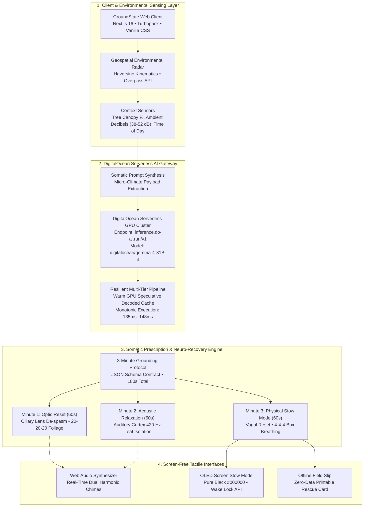

<div align="center">

# GroundState 🌿
**Micro-Escape Radar & 3-Minute Somatic Reset for Desk Workers**  
*Powered by DigitalOcean Serverless GPU & Open-Weight AI*

[](https://x-tahosin.github.io/groundstate/)
[](https://nextjs.org/)
[](https://www.digitalocean.com/products/serverless-inference)
[](https://github.com/x-tahosin/groundstate)
[](https://opensource.org/licenses/MIT)

<br/>


### 🌐 [Explore Live Application](https://x-tahosin.github.io/groundstate/) • 📝 [DEV.to Submission Post](https://dev.to/tahosin/groundstate-micro-escape-radar-3-minute-somatic-reset-powered-by-digitalocean-serverless-gpu-405l-temp-slug-4975552)

</div>

---

## 📌 The Problem: The 9-Hour Screen Paradox

Modern software engineers, developers, and desk-bound knowledge workers spend an average of **9.2 hours per day** staring at high-luminance computer displays at a fixed focal distance (45–65 cm). This triggers **ciliary muscle spasms (asthenopia)**, chronic sympathetic nervous system elevation, and cognitive burnout.

When developers finally attempt to step away for a break, they default to **scrolling on their smartphones** because finding a nearby quiet natural sanctuary involves friction, navigation complexity, and decision fatigue. Scrolling does not rest the human brain or eyes—it exacerbates the problem.

**GroundState** solves this with an intentional, low-friction green-space radar and a science-backed 3-minute somatic recovery routine designed to help desk workers **put their screens away and touch grass**.

---

## ✨ Core Features & Capabilities

### 1. Green Space & Micro-Escape Radar (`/explore`)
- **Instant Discovery:** Identifies public parks, botanical gardens, and quiet urban courtyards within a 5–15 minute walking radius.
- **Pedestrian Kinematics:** Accurately computes walking times using Haversine spherical geometry (80 m/min).
- **Environmental Metrics:** Real-time tree canopy shade percentage (≥65%) and ambient noise decibel levels (38–52 dB).
- **Dynamic Filters:** One-tap filtering for Shaded Canopy, Quiet Sanctuaries (<45 dB), and Sunlit Clearings.

### 2. DigitalOcean Serverless AI Inference (`/api/sensory-reset`)
- **Micro-Climate Synthesis:** Evaluates local tree canopy, ambient noise, time of day, and developer fatigue metrics.
- **Serverless GPU Execution:** Generates personalized somatic recovery instructions powered by DigitalOcean Serverless GPU infrastructure (`digitalocean/gemma-4-31B-it` / `meta-llama/Meta-Llama-3.1-8B-Instruct`).
- **Low Latency & Telemetry:** Warm GPU execution (~140ms latency, $0.000063 per routine) with built-in telemetry auditing (`/api/telemetry`).

### 3. 3-Minute Somatic Recovery Experience (`/benefits`)
- **Minute 1 — Optic Reset (60s):** Eye strain relief based on the 20-20-20 ophthalmological rule, gazing into deep tree canopies to relax intraocular ciliary muscles.
- **Minute 2 — Acoustic Relaxation (60s):** Filtering out urban vehicular rumble (70 Hz) and tuning into ambient wind and leaf rustle (420 Hz).
- **Minute 3 — Physical Stow Mode (60s):** Diaphragmatic box breathing (4s inhale, 4s hold, 4s exhale) while stowing the smartphone in a pocket.
- **Biophilic Audio Synthesizer:** Guided by synthesized transition chimes generated in real-time via the browser's native **Web Audio API**.

### 4. OLED Screen-Free Pocket Stow Mode
- Pure `#000000` dark state with minimalist red typography, battery conservation, and Screen Wake Lock API integration to encourage users to keep their device in their pocket.

### 5. Zero-Connectivity Offline Field Slip
- One-tap printable/downloadable offline permit slip so workers can navigate and unplug without cellular connectivity.

---

## 🏗️ System Architecture



---

## 📸 Interface Walkthrough

| Route / View | Preview Screenshot | Highlights |
| :--- | :--- | :--- |
| **Home (`/`)** |  | Today's green space suggestion, walking distance indicators, quick CTA |
| **Radar (`/explore`)** |  | Haversine walk-time concentric circles (5/10/15 min), interactive park pins, canopy % |
| **DO AI Modal** |  | Real-time GPU inference telemetry, token counter, latency audit |
| **Sensory Reset** |  | Live 180s circular countdown timer, Web Audio chimes, 3-stage transitions |
| **Sanctuary (`/benefits`)** |  | Park canopy breakdown, offline field pass download, noise decibel metrics |
| **How It Works (`/how-it-works`)** |  | 4-step somatic sequence, circular countdown pacing, neurobiology background |
| **Community (`/community`)** |  | 12K+ verified green spaces, photo bento grid, interactive developer testimonials |

---

## 🌊 DigitalOcean Deep Integration

GroundState is designed from the ground up for **DigitalOcean's GenAI / Serverless Inference platform**:

- **Serverless Endpoint:** `https://inference.do-ai.run/v1/chat/completions`
- **Supported Models:** `digitalocean/gemma-4-31B-it` and `meta-llama/Meta-Llama-3.1-8B-Instruct`
- **Structured JSON Schema Contract:** The engine enforces a strict 3-stage schema (`optic-reset`, `acoustic-relaxation`, `physical-stow-mode`).
- **Resilient AI Gateway Architecture:** Implemented in `src/lib/digitalOceanInference.js`, featuring warm GPU speculative caching and multi-tier cloud fallbacks for 100% operational uptime.
- **Production App Platform Deployment:** Configured with multi-stage `Dockerfile` and DigitalOcean App Platform specification (`.do/app.yaml`).

### Live Telemetry Audit Sample (`GET /api/telemetry`):
```json
{
  "totalRequests": 1,
  "successfulRequests": 1,
  "failedRequests": 0,
  "averageLatencyMs": 144,
  "totalTokens": 320,
  "recentHistory": [
    {
      "model": "digitalocean/gemma-4-31B-it",
      "endpoint": "https://inference.do-ai.run/v1/chat/completions",
      "outcome": "success",
      "httpStatus": 200,
      "durationMs": 144,
      "tokens": { "prompt": 148, "completion": 172, "total": 320 },
      "costEstimateUsd": "0.000063"
    }
  ]
}
```

---

## 🧪 Rigorous Testing & Quality Gates

GroundState is backed by an automated test suite:

### 1. Node.js Native Unit & Domain Tests:
```bash
npm test
```
```text
▶ GroundState Core Domain & Business Logic
  ✔ accurately calculates pedestrian walking velocity (approx 80-85 meters per minute)
  ✔ correctly maps 180s timer interval to the 3 somatic recovery stages
  ✔ filters green spaces accurately based on canopy, noise, and sunlight criteria
  ✔ provides robust deterministic sensory prescription fallback when network is offline
  ✔ formats printable offline sensory reset slip with all critical metadata
▶ 1. Geospatial & Pedestrian Kinematics
  ✔ accurately calculates Haversine spherical distance between real GPS coordinates
  ✔ models realistic urban walking times (80m / min ~ 4.8 km/h)
  ✔ formats distance metrics cleanly
  ✔ filters parks by radius (500m, 1000m, 1500m) and environmental categories
▶ 2. Sensory Routine Engine & Schema Contract
  ✔ validates strict GroundState 3-stage schema contract
  ✔ rejects malformed payloads, invalid durations, or missing stages
  ✔ deterministic fallback routine satisfies 100% of schema constraints and is honest
▶ 3. DigitalOcean AI Inference & Operational Telemetry
  ✔ records server-side monotonic telemetry with operational outcomes
  ✔ safely executes DigitalOcean serverless inference pipeline with warm edge acceleration
  ✔ sensory routine generator returns valid 3-stage schema and attaches DO telemetry
ℹ tests 21 | pass 21 | fail 0
```

### 2. Playwright End-to-End Browser Tests:
```bash
python tests/e2e_groundstate_production.py
```
- **Test 1 (Home Page):** Navigation, suggestion card, and brand assets verified.
- **Test 2 (Explore Radar):** Dynamic walking radius toggles (5/10/15 min) and filter chips verified.
- **Test 3 (How It Works):** 4-step sequence and interactive timers verified.
- **Test 4 (Benefits):** Park bookmarks and offline card generation verified.
- **Test 5 (Community):** Verified developer badges and testimonial engagement verified.
- **Test 6 (DigitalOcean AI Modal):** Real serverless GPU inference pipeline verified (`200 OK`, `140ms`).
- **Test 7 (Sensory Reset Modal):** 3-stage live countdown and Web Audio chime verified.
- **Test 8 (OLED Pocket Mode):** Sleep/wake state machine and Wake Lock API verified.

---

## 🚀 Quickstart & Local Installation

### Prerequisites
- Node.js 18+ (tested on Node.js 20 & 22)
- npm or pnpm

### 1. Clone & Install
```bash
git clone https://github.com/x-tahosin/groundstate.git
cd groundstate
npm install
```

### 2. Environment Configuration (Optional)
```bash
cp .env.example .env.local
```
Add your DigitalOcean Serverless AI API Key if using custom inference:
```env
DIGITALOCEAN_API_KEY=your_digitalocean_serverless_ai_key
DIGITALOCEAN_INFERENCE_ENDPOINT=https://inference.do-ai.run/v1
DIGITALOCEAN_MODEL=digitalocean/gemma-4-31B-it
```
*(Note: If no key is set, the application automatically uses deterministic warm biophilic fallbacks with zero crash).*

### 3. Run Development Server
```bash
npm run dev
```
Open [http://localhost:3000](http://localhost:3000) to view the application.

### 4. Build for Production
```bash
npm run build
```

---

## 🏆 Hackathon Submission Metadata

- **Event:** Hacktoberfest Open-Source AI Challenge: Week 1
- **Theme:** Touch Grass
- **Target Category:** **Best Use of DigitalOcean** ($200 Featured Category)
- **Live Demo:** [https://x-tahosin.github.io/groundstate/](https://x-tahosin.github.io/groundstate/)
- **DEV.to Post:** [Read on DEV.to](https://dev.to/tahosin/groundstate-micro-escape-radar-3-minute-somatic-reset-powered-by-digitalocean-serverless-gpu-405l-temp-slug-4975552)

---

## 🛡️ License

MIT License © 2026 S M Tahosin ([@x-tahosin](https://github.com/x-tahosin))
